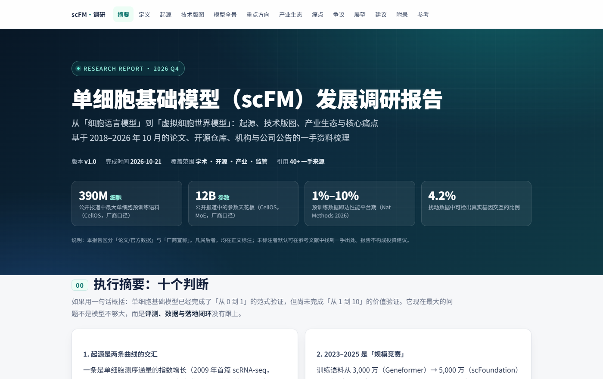

# 单细胞大模型调研（信息截至 2026-10）

单细胞基础模型从 2021 年走到现在，模型数量涨得比结论快。这份调研把这条线梳了一遍：27 款模型、13 项独立评测、47 条来源，写成一份 50 页的报告、一份 23 页的汇报稿，外加一个能点的交互页。

报告没有按年表写。按年表写，读完只记得时间顺序，不记得谁解决了什么。所以换了两个坐标来组织：

- **建模的第一性对象**：基因、细胞、整条表达谱、状态分布，还是自然语言；
- **学习信号**：掩码重建、序列似然、对齐或预测、隐空间预测。

两个坐标能组合出的东西不多，最后落在六个架构大类上。主干网络（Transformer / Performer / RetNet / Mamba）单独拎出来当正交维度——它决定工程上好不好跑，不决定模型学到什么。同一个 Mamba 会出现在两类毫不相干的模型里（RegFormer 拿它做掩码基因建模，AlphaCell 拿它做状态转移编码），失败方式也没有共同点。



## 文件

| 路径 | 说明 |
|---|---|
| [docs/单细胞大模型_问题与架构_调研报告.pdf](docs/单细胞大模型_问题与架构_调研报告.pdf) | 主报告 PDF，A4 / 50 页 / 约 5.8 万字，6 图 29 表 |
| [docs/单细胞大模型_问题与架构_调研报告.docx](docs/单细胞大模型_问题与架构_调研报告.docx) | 同上的 DOCX，目录带真实页码，可直接改 |
| [docs/单细胞大模型_交互版.html](docs/单细胞大模型_交互版.html) | 交互摘要，单文件、零外部依赖，双击就能开 |
| [docs/单细胞大模型_问题与架构_汇报.pptx](docs/单细胞大模型_问题与架构_汇报.pptx) | 汇报稿，16:9 / 23 页，按 30–40 分钟讲 |
| [docs/单细胞大模型_问题与架构_汇报.pdf](docs/单细胞大模型_问题与架构_汇报.pdf) | 汇报稿的 PDF，投屏或发邮件用 |
| [docs/v1_单细胞基础模型调研报告_2026-10-21.pdf](docs/v1_单细胞基础模型调研报告_2026-10-21.pdf) | 上一版，侧重模型全景、产业生态和争议，32 页 |
| [figs/](figs/) | 报告与汇报稿共用的 6 张图，300 dpi |
| [notes/](notes/) | 五篇专题笔记：评测与批评性研究、中国生态、虚拟细胞产业、连续值表示、2026 前沿补充 |
| [src/](src/) | 生成图和文档的脚本 |
| [literature/](literature/) | 另一条线的调研：32 篇 AI + 生物重要论文的清单与报告 |

交互页支持深链接，讲的时候能直接跳到某一页：`…html#problems/p3` 定位 P3，`#arch`、`#models`、`#matrix`、`#choose` 对应各章节，`#model/State` 直接打开某个模型的弹窗。问题列表用 ←/→ 切换，Esc 关弹窗。

## 几条结论

**数据层的麻烦没有架构解。** 贴着数据层的四个问题（P1 规模幻觉、P2 噪声与批次、P3 数据泄漏、P4 长尾与偏移）里，只有 P2 有真正的架构手段——显式协变量、噪声建模、集合损失。覆盖矩阵上 P3 整行为空：没有任何架构能解决它，只能靠时间切分和逐细胞审计。把希望寄托在「更大的模型」上，是这类问题最常见的误配。

**zero-shot 的叙事已经破了，微调的价值还在。** Kedzierska 等在 5 个数据集上的零样本评测、Boiarsky 等对 scBERT 的复现、Ahlmann-Eltze 等拿线性基线做的对撞，都没能支持「预训练带来通用能力」。但换个问法结论就变了：预训练模型普遍好于随机初始化，微调加分布外泛化确实有效，而且训练样本越少优势越明显。

**2025 年之后的新模型在换监督信号，不是加参数。** State 用 256 个细胞的集合配 MMD 损失，AlphaCell 用最优传输流匹配，Lingshu-Cell 用条件离散扩散，CellOS 用 JEPA 在隐空间预测。这条线索比「谁的参数多」有用得多。

**评测和要回答的问题错位。** 多数基准还在用 MSE、Pearson 或聚类一致性打分，而模型真正该回答的是「敲掉这个基因之后，哪些基因会变」。Norman 双扰动上，所有被测模型的误差都高于「两个单扰动相加」的朴素基线，真有信息的交互只占 4.2%。这不是模型不够大，是指标没对准问题。

写作过程中，17 款模型的架构参数（层数、维度、分箱数、掩码比例、词表大小）是照着官方源码核的。和论文正文对不上的地方，以代码为准。

## 重新生成

```powershell
pip install python-docx python-pptx matplotlib numpy PyMuPDF Pillow

python src/make_figs.py      # 生成 figs/*.png
python src/build_report.py   # 生成 DOCX + PDF
python src/build_deck.py     # 生成汇报 PPTX
```

`build_report.py` 用两遍法排版：先排一遍、导出 PDF、从 PDF 里定位各级标题的真实页码，再回填目录重排；第二遍页码有变化会自动再跑一次。导出 PDF 需要 LibreOffice，路径可用环境变量 `SOFFICE` 指定。

字体在 `src/report_lib.py` 里：正文宋体、标题微软雅黑，Windows 自带。换到 macOS 或 Linux 需要改成 PingFang / Noto Sans CJK，图的字体列表在 `src/make_figs.py` 顶部。

## 没放什么

完整文献库没有放进来。原来的工作区里有 32 篇论文的 PDF（395 MB）和 42 篇的中英对照精读页（正文、图表、逐段翻译），合计约 2.9 GB。这些 PDF 的版权属于出版社或作者，精读页里的原文和插图同样是派生内容，公开仓库不适合承载。

能放的是清单：[literature/papers.csv](literature/papers.csv) 给了 32 篇的题名、作者、年份、DOI、引用量和 OA 状态，按 DOI 自己取全文就行。

## 口径

- 信息截至 **2026-10**。这个方向进展很快，隔几个月再看，结论可能要改。
- 厂商口径（CellOS 的 12B 参数、3.905 亿细胞、Pearson_edist 0.619 等）在报告里单独标注，未经独立复现。
- 不同论文的细胞计数口径不同（去重、质控、是否含多物种），跨模型比较只看数量级。
- 报告不评「谁最强」，只评「每种设计换来了什么、付出了什么」。

## 许可

- `src/` 下的代码：MIT，见 [LICENSE](LICENSE)。
- `docs/`、`figs/`、`notes/`、`literature/` 下的文字、图与文档：CC BY 4.0，见 [LICENSE-docs](LICENSE-docs)。

引用或用到图，注明仓库地址即可。

## 引用

```bibtex
@misc{scfm_survey_2026,
  title  = {单细胞大模型：12 个问题、6 类架构、27 个模型},
  author = {sleepSleepsleep-lab},
  year   = {2026},
  note   = {调研报告，信息截至 2026-10},
  url    = {https://github.com/sleepSleepsleep-lab/single-cell-foundation-models-survey}
}
```

报告里的判断都标了来源，但引用二手转述时建议回到原文核对数字。发现错误开个 issue。
